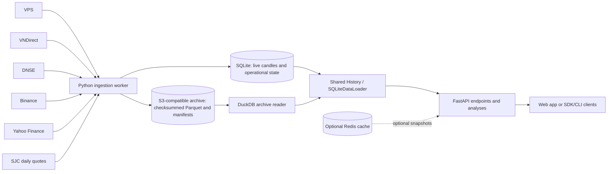

# Data flow

This page describes the supported Python service. The deprecated Rust service
is preserved under [`legacy/rust/`](legacy/rust/README.md).

The worker fetches provider pages, validates and stages rows, then commits
accepted candles and operational receipts to SQLite. Archive maintenance writes
verified historical data as Parquet objects and publishes manifests. Reads use
the shared history loader, which fetches bounded SQLite rows and consults the
archive for older ranges as needed; the two sources are reconciled by their
source, symbol, interval, and timestamp identity.

The API does not use the deprecated Rust/PostgreSQL service as its OHLCV source.
Compose may use the production API only for ticker-catalog initialization; this
is metadata bootstrapping, not a price-data feed. Redis is disabled by default
in local Compose and can accelerate compatibility reads when configured. SQLite
and the archive remain the durable data sources.

API request modes and stored source identities are distinct. `mode=yahoo`
returns Yahoo and SJC records, while stored source identities remain `yahoo`
and `sjc`; `mode=all` includes configured sources. SJC rows are synthesized
from buy/sell quotes and placeholder volume, not exchange-traded candles.

See [data sources](docs/DATA_SOURCES.md), the [API contract](aipriceaction-api/CONTRACT.md),
and the [migration runbook](aipriceaction-api/MIGRATION.md).
