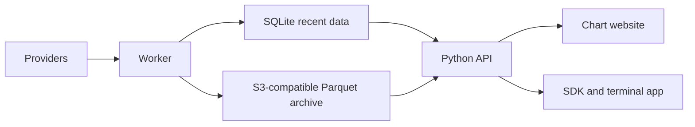

# AIPriceAction

AIPriceAction provides market data and analysis for Vietnamese stocks, crypto,
global markets, and SJC gold. This repository contains the Python API, its data
worker, the terminal app, a Python SDK, and agent skills. The chart website is
maintained in a separate repository.

## Start here

- Run the API and worker: [API quick start](aipriceaction-api/README.md)
- Run the chart website locally: [web setup](aipriceaction-api/README.md#run-the-chart-website)
- Use the terminal app: [AIPA Terminal](aipriceaction-terminal/README.md)
- Use the Python client: [Python SDK](sdk/aipriceaction-python/README.md)
- Review the API routes: [API contract](aipriceaction-api/CONTRACT.md)
- Understand storage and providers: [data flow](DATA_FLOW.md) and [data sources](docs/DATA_SOURCES.md)

## How the system works



The worker fetches and validates market data. The API serves recent SQLite
data and older verified archive data. Local Compose runs RustFS as the S3
store. A healthy API does not mean every ticker has finished loading.

The Python API is the supported backend. The retired Rust API is kept under
[`legacy/rust/`](legacy/rust/README.md) for reference. RustFS is still used by
the Python stack as an object store; it is a separate service.

## Local setup

From `aipriceaction-api/`, copy `.env.example` to `.env` only for a new local
setup. Set a non-empty `REFRESH_SECRET`, then run:

```sh
docker compose up -d --build
curl --fail http://localhost:8899/health
```

This local setup uses its RustFS container and local development settings. Do
not use `.env.example` as a production configuration. See the [API guide](aipriceaction-api/README.md)
for ports, data paths, logs, and web setup.

## Repository map

| Path | Purpose |
| --- | --- |
| `aipriceaction-api/` | Python API, worker, storage, Compose setup, and tests |
| `aipriceaction-terminal/` | `aipa` command-line and terminal interface |
| `sdk/aipriceaction-python/` | Installable Python SDK |
| `skills/` | Agent workflows for market data and analysis |
| `legacy/` | Retired Rust backend and superseded documentation |

Use [API validation notes](aipriceaction-api/VALIDATION.md) for recorded local
measurements. They are not production service guarantees.
