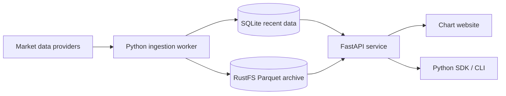

# AIPriceAction

AIPriceAction is a market-data service and a set of clients for Vietnamese
stocks, crypto, and global assets. This repository contains the supported
Python API, its ingestion and storage services, a terminal client, a Python SDK,
and analysis workflows. The chart website source is maintained in a separate
`aipriceaction-web` repository.

## Choose a starting point

- **Run the API and data worker locally:** follow [the API quickstart](aipriceaction-api/README.md#start-locally).
- **Run the chart website locally:** first start the API, then follow [the web setup](aipriceaction-api/README.md#run-the-chart-website).
- **Fetch data or analyze tickers from a terminal:** see [AIPA Terminal](aipriceaction-terminal/README.md).
- **Use the Python client in your own code:** see the [Python SDK](sdk/aipriceaction-python/README.md).
- **Understand the system before changing it:** read [the data flow](DATA_FLOW.md), [data sources](docs/DATA_SOURCES.md), then the [API contract](aipriceaction-api/CONTRACT.md).

## Current implementation

The supported API implementation is the Python service in
[`aipriceaction-api/`](aipriceaction-api/README.md). The Rust source is retained
under [`legacy/rust/`](legacy/rust/README.md) for reference; the Rust API is
deprecated. See the
[migration runbook](aipriceaction-api/MIGRATION.md) for deployment steps.

RustFS is still an active part of the Python stack: it stores archived Parquet
history through an S3-compatible interface. RustFS is separate from the retired
Rust API.

## How the pieces fit

Compose runs the API, an ingestion worker, an initializer, and RustFS. The
initializer downloads ticker catalog metadata; it does **not** import old Rust
PostgreSQL price history. The worker fetches price history from the configured
providers, so it needs outbound network access. A healthy API process does not
mean all tickers have finished loading or have fresh candles.

## Repository map

| Path | What it contains |
| --- | --- |
| `aipriceaction-api/` | Supported FastAPI service, shared history loader, ingestion worker, storage, Docker Compose, scripts, and API tests |
| `aipriceaction-terminal/` | `aipa` command-line tool and terminal UI |
| `sdk/aipriceaction-python/` | Installable Python SDK and analysis helpers |
| `skills/` | Agent workflows for fetching and analyzing market data |
| `docs/`, `DATA_FLOW.md`, `FEATURES.md` | Current architecture, data policies, and feature overview |
| `legacy/` | Retired Rust API and superseded documentation; not the current runtime |

`AGENTS.md` describes market-analysis behavior for AI agents; it is not the
repository's software build guide. Use the API and client READMEs for setup.

## Local setup

The API uses host port `8899` and is reachable from the LAN when the host
firewall allows it. RustFS ports `9100` and `9101` bind to loopback by default.
The chart website runs on port `5173` when started with the local launcher. For
exact prerequisites, data locations, startup checks, and cleanup commands,
follow the [API quickstart](aipriceaction-api/README.md).

When you copy `.env.example`, Vietnamese provider ingestion needs either
`HTTP_PROXIES` or `ALLOW_DIRECT=true` in the local API `.env`. First startup also
needs internet access to refresh catalog metadata and fetch provider data.

## Checks and performance evidence

API tests and lint commands are listed in the [API guide](aipriceaction-api/README.md#development-checks).
The latest local 19-request home-page benchmark, including its scope and
reproduction command, is in [validation evidence](aipriceaction-api/VALIDATION.md).
